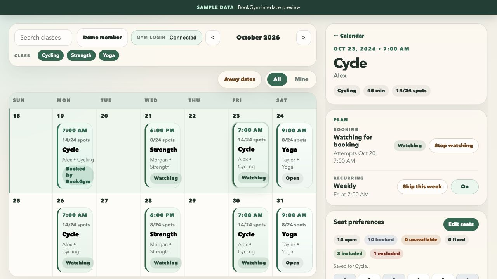

# BookGym

Recurring gym schedules, seat preferences, and automated class bookings.

I built BookGym to turn a weekly plan into reservations without having to be online when each class opens. It runs on a Raspberry Pi for personal use. A Python service works with an existing gym website through Playwright; a calendar shows what is scheduled, booked, or needs attention.



The screenshot uses invented classes and account data. This repository contains the application source and tests, with generic configuration defaults. It does not include a running account, gym credentials, or booking history.

## What it does

- Maintains recurring class selections, one-week skips, and away dates.
- Schedules booking attempts around each class's booking window.
- Applies ranked seat preferences, exclusions, and fallback policies.
- Stores jobs and events so confirmed bookings, waitlists, failures, and uncertain attempts remain distinguishable.
- Supports passwordless sign-in and delegated management with actor and member attribution.
- Separates the calendar/API from the background booking worker.

## Code to explore

| Area | Main files |
| --- | --- |
| Calendar, API, and operator views | `app/main.py`, `app/static/admin.js`, `app/templates/` |
| Weekly rules and away dates | `app/weekly_schedule.py`, `app/booking_pauses.py` |
| Booking timing and execution | `app/scheduler.py`, `app/jobs/book_class.py`, `app/booking_time.py` |
| Website integration | `app/adapters/gym_site.py` |
| Identity and delegation | `app/app_auth.py`, `app/models.py` |
| Seat selection | `app/seat_preferences.py`, `app/seat_layout.py` |

The adapter targets one booking system. Configuring a different URL alone does not make it a universal gym integration; a different system may need an adapter change.

## Local setup

Use Python 3.12. From the repository root:

```sh
python3 -m venv .venv
source .venv/bin/activate
python -m pip install -r requirements.txt
python -m playwright install chromium
cp .env.example .env
```

For a local calendar/API with bookings disabled:

```sh
BOOKGYM_PREVIEW_MODE=true python -m uvicorn app.main:app --host 127.0.0.1 --port 8001
```

Open `http://127.0.0.1:8001`. A clean checkout starts with no class data. Gym discovery requires your own configuration and account; the example values are placeholders. Preview mode blocks real bookings but permits configured gym reads. App login is disabled by default for local setup, so keep this development server on loopback.

## Tests

```sh
python -m unittest discover -s tests
```

The tests use temporary databases and mocked website/email interactions. They do not require an actual gym account.

## Operation

`scripts/run_scheduler.py` runs the booking worker separately. Run only one worker for a booking account. Production access requires configured authentication, secure cookies, allowed hosts, and HTTPS.

The `scripts/` directory also includes Raspberry Pi deployment and earlier Mac service tooling. Deployment targets, user names, paths, and application configuration must be adapted to your environment. `--initial` deployment and `cutover_to_pi.sh` are initial setup operations that move runtime state; ordinary updates use `deploy_pi.sh` without `--initial`.

SQLite files, `.env`, browser sessions, preview copies, and captured network artifacts are local runtime data and excluded from Git.

## Local deployment settings

Optional `.local/deploy.env` supplies machine-specific defaults for `BOOKGYM_PI_HOST`, `BOOKGYM_PI_DIR`, and `BOOKGYM_PI_USER`. Keep this file out of Git; `.local/` is also excluded from deployment uploads. Explicit environment overrides should take precedence in that file. Pi setup uses `BOOKGYM_PI_USER` when supplied, otherwise the invoking sudo user (falling back to `pi`).
